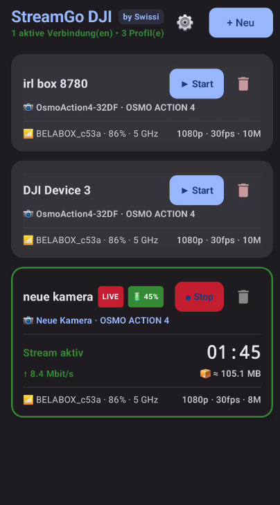
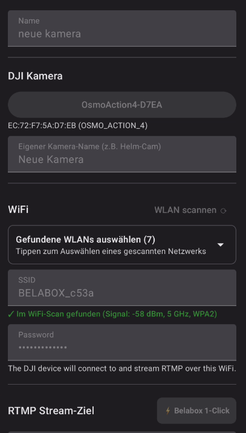
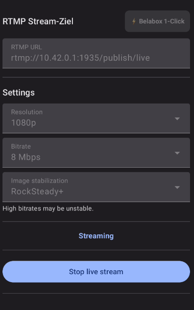
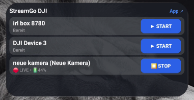

# StreamGo DJI by Swissi 🇨🇭

Die schnelle, zuverlässige Android-App zur Steuerung von DJI Action- und Pocket-Kameras über Bluetooth für ultra-stabiles RTMP-Live-Streaming (z.B. zu Belabox, Twitch, YouTube).

> [!NOTE]
> **✨ 100% Vibe Coding Projekt:**  
> Ich bin kein professioneller Entwickler und habe ehrlich gesagt keine tiefe Ahnung von Android-Code – aber durch **Vibe Coding** mit KI baue und teste ich mir das Ding genau so zusammen, bis es für mich in der Praxis perfekt funktioniert! 🚀

---

## ⚠️ Getestete Kameras
- ✅ **DJI Osmo Action 4**: Ausführlich von mir in der Praxis getestet und bestätigt. Funktioniert einwandfrei!
- ❓ **Andere Modelle (Action 5 Pro, Action 6, Pocket 3/4)**: Im Code theoretisch vorhanden/unterstützt, aber **von mir bisher NICHT getestet**. Feedback und Tests sind willkommen!

---

## Features
- ⚡ **1-Click Stream direkt aus der Profil-Liste** (Start / Stop ohne Klick-Umwege)
- 📱 **Android Homescreen Widget** (Live-Stream direkt vom Smartphone-Homescreen starten & stoppen inkl. Status & Akkuanzeige)
- 🔍 **Integrierte WLAN-Suche & Scanner** (zeigt verfügbare Netzwerke mit Signalstärke, GHz-Band & Verschlüsselung direkt zur Auswahl)
- 🏷️ **Eigene Kamera-Namen / Nicknames** (z.B. Helm-Cam, Bike, Rucksack zur perfekten Unterscheidung)
- ⚡ **1-Click Belabox Setup** (automatisches Ausfüllen der RTMP-URL für Belabox Hotspots)
- 📊 **Echtzeit-Telemetrie**:
  - Live-Encoder-Bitrate (Mbit/s)
  - Stream-Laufzeit (Stoppuhr) & geschätztes Datenvolumen (MB / GB)
  - Live-Akkuanzeige & Kamera-Temperatur (°C)
  - WLAN-Signalstärke & Frequenzband (2.4 / 5 GHz)
- 🔄 **Automatischer Reconnect bei Signalverlust** (verbindet bei Funkausriss ohne Nachfragen sofort neu)
- 🛑 **Intelligente manuelle Abbruch-Erkennung** (kein ungewollter Reconnect bei Stop am Touchscreen der Osmo oder in der App)
- 📋 **Beliebige Profile verwalten & einzeln löschen** (ideal für Belabox, Heim-WLAN, mobile Hotspots)
- ⏱️ **Zero-Friction UI**: Minimaler Overhead, maximale Stabilität in der Praxis

---

## Screenshots

| Profile & Live-Status | Kamera & WLAN | Stream-Einstellungen | Android Homescreen Widget |
|:---:|:---:|:---:|:---:|
|  |  |  |  |

---

## Credits & Danksagung
Basierend auf Vorarbeiten von [dimadesu/dji-remote](https://github.com/dimadesu/dji-remote), [Moblin](https://github.com/eerimoq/Moblin) und dem reverse-engineerten DJI-Bluetooth-Protokoll von [Spillmaker](https://github.com/Spillmaker).

## Lizenz
Dieses Projekt steht unter der [MIT License](LICENSE).  
Ursprünglicher Code Copyright (c) 2026 Dmytro Antonov / Erweiterungen & Anpassungen Copyright (c) 2026 Swissi.
